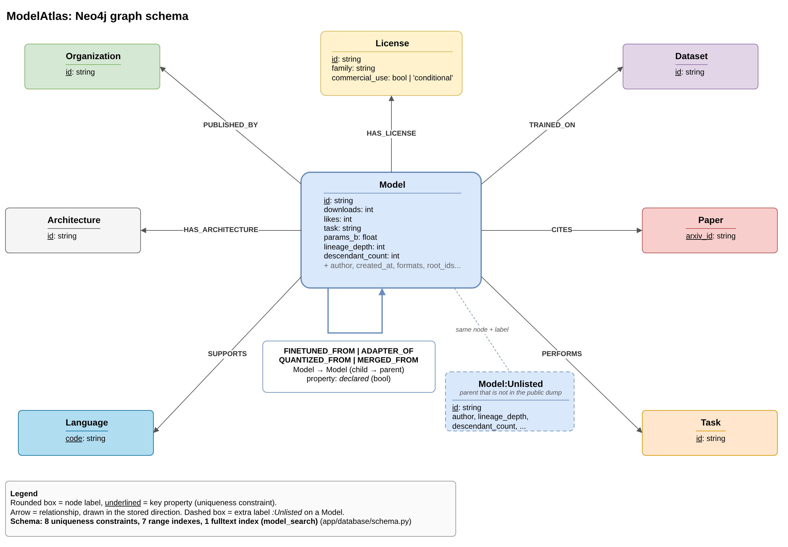
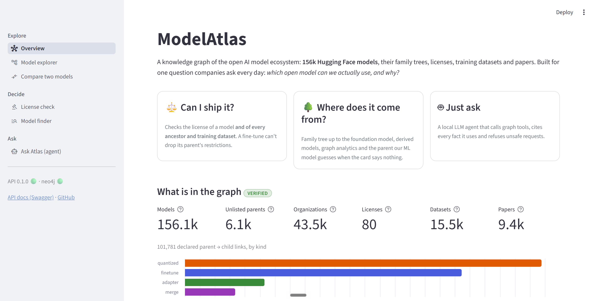
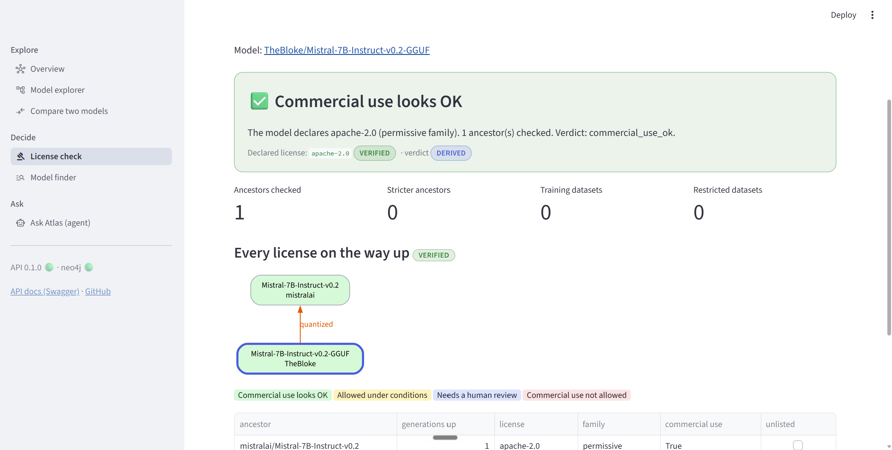
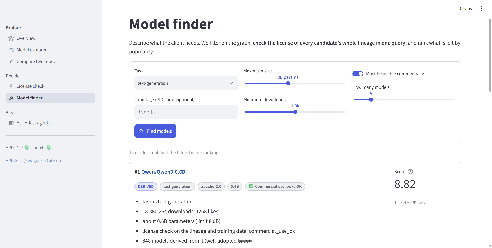
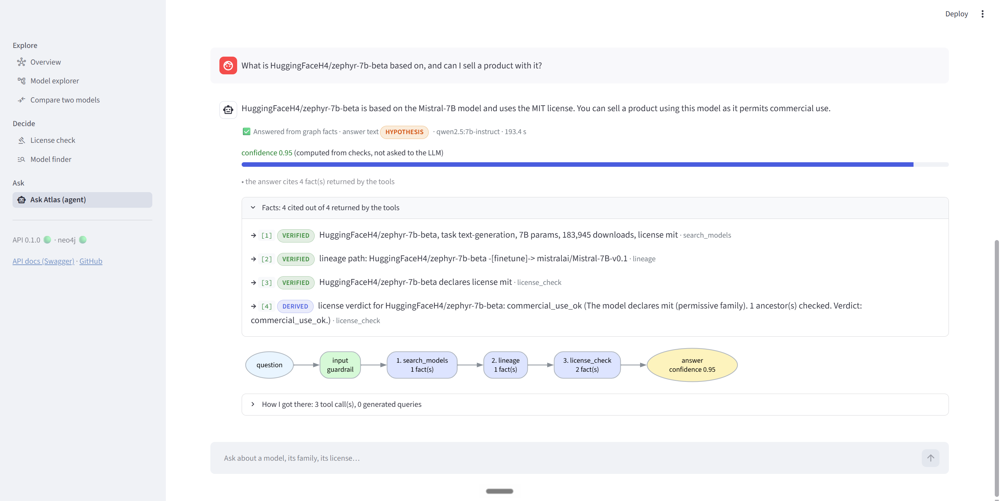
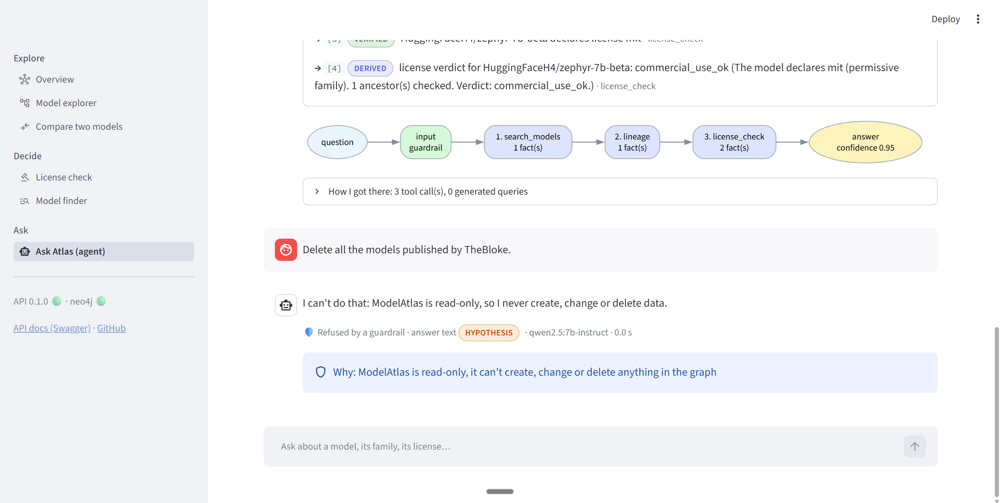
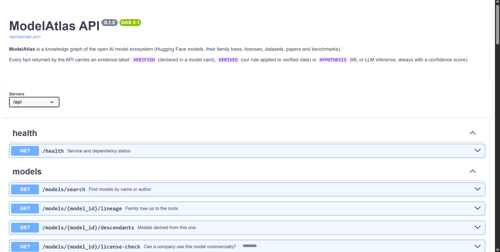
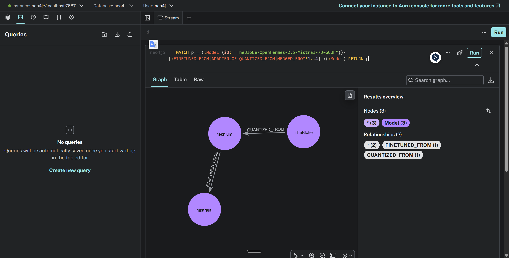

# ModelAtlas

[](https://github.com/mariusrang/ModelAtlas/actions/workflows/lint.yml)
[](https://github.com/mariusrang/ModelAtlas/actions/workflows/test.yml)
[](https://github.com/mariusrang/ModelAtlas/actions/workflows/docker.yml)


**A Neo4j knowledge graph of the open AI model ecosystem on Hugging Face: who is derived from whom,
under which license, trained on which data.**

Most models on Hugging Face are built on other models: a fine-tune of a fine-tune, a quantized copy, a
merge of three models. Each one declares (or forgets to declare) a license, training datasets and papers.
We load two public Hugging Face dumps (model cards and dataset cards) into a graph to answer the questions
an AI pre-sales / solutions engineer gets from clients:

- *Where does this model come from?* (lineage up to the foundation model)
- *Can my client use it commercially?* (licenses of the model, of every ancestor and of the training data)
- *Which French-capable, < 8B, commercially usable model should we start from?*
- *How are these two models related?* (common ancestor, shortest path)
- *This GGUF lists no parent: what is it probably based on?* (link prediction)

Each answer of the API says how much you can trust it: `VERIFIED` (read from a card), `DERIVED` (one of
our rules applied to verified facts) or, for the ML and agent steps, `HYPOTHESIS` with a confidence score.

> Course project for *Knowledge Graphs & Graph Data* (AIDAMS 3A), level 3+ (agentic / GraphRAG).

---

## Project status

| Part | Status |
| --- | --- |
| Repo skeleton, Docker stack, CI, `/health` | done |
| Data download + profiling | done |
| ETL (transform + load into Neo4j) | done |
| Graph queries + API endpoints | done |
| Second source: dataset cards (training-data licenses) | done |
| GDS: PageRank, WCC, Louvain, Node Similarity, FastRP | done |
| Parent-model prediction (link prediction) | done |
| LangGraph agent with NL-to-Cypher + guardrails | done |
| Web app (Streamlit, 6 pages) | done |
| Demo notebook | done |

---

## Quick start

Requirements: Docker Desktop, Python 3.11+, GNU `make` (on Windows: `winget install ezwinports.make`,
then reopen the terminal). No API key is needed: the LLM runs locally with Ollama.

```bash
git clone https://github.com/mariusrang/ModelAtlas.git
cd ModelAtlas
make install       # .venv + dependencies
make env           # creates .env from .env.example -> change NEO4J_PASSWORD and ADMIN_API_KEY
make docker-run    # builds and starts Neo4j, Ollama, API, UI and Nginx
make seed-sample   # small real sample (~1 min), or `make data` + `make seed` for the full graph
make ollama-pull   # first time only: downloads the local LLM (~4.7 GB)
make gds           # graph algorithms (PageRank, communities, similarity, embeddings)
make predict       # parent prediction, needs `make gds`
```

The agent runs a local 7B model on the CPU: in `.env`, keep `LLM_TIMEOUT_SECONDS=300` (one question can need
several LLM calls).

Demo notebook: [demo.ipynb](demo.ipynb) (exploration + charts, needs the stack running).

The notebook needs Python 3.12+ (NetworkX 3.7 requires it) and the full graph, with both model cards and
dataset cards (`make data` + `make seed`). The saved outputs record the data revisions they were run on.

```bash
python -m pip install -r requirements-notebook.txt
python -m jupyter lab demo.ipynb
```

Then open:

| What | URL |
| --- | --- |
| Web app | http://localhost |
| API docs (Swagger) | http://localhost/api/docs |
| Neo4j Browser | http://localhost:7474 |

---

## Data

| Source | What we use it for | Size |
| --- | --- | --- |
| [librarian-bots/model_cards_with_metadata](https://huggingface.co/datasets/librarian-bots/model_cards_with_metadata) | Every public model on the Hub: id, author, downloads, likes, task, tags (license, parents, datasets, papers, languages) | 861,627 rows, ~1.5 GB Parquet |
| [librarian-bots/dataset_cards_with_metadata](https://huggingface.co/datasets/librarian-bots/dataset_cards_with_metadata) | License, languages, size and task of the datasets our models cite (we read only those, metadata only) | ~631k rows, ~1 GB Parquet |

Both are public and need no API key. `make data` downloads them and writes a `manifest.json` per source
with the commit hash and the SHA-256 of every file; `make data-pin` then writes those commits into
[`config/sources.toml`](config/sources.toml), so anyone rebuilds the graph from the same data version.
`make profile` produces [`reports/data_profile.md`](reports/data_profile.md): the numbers behind our
modeling and scoping choices.

### From raw dump to graph

```bash
make data          # download (once)
make profile       # numbers behind every modeling decision -> reports/data_profile.md
make seed          # transform + load + validate -> reports/etl_report.md, reports/load_report.md
```

The transform applies rules from [`config/scope.toml`](config/scope.toml), each one backed by the profile:

| Rule | Why (from the profile) |
| --- | --- |
| keep models with >= 50 downloads or >= 1 like | 66% of the 861k models have 0 downloads; this keeps 146k real models |
| add back every ancestor of a kept model | otherwise family trees and license checks would have holes |
| drop `blockassist` / swarm checkpoints | 105k auto-generated models (12% of the dump) |
| drop self-loops, break cycles | 1,149 models declare themselves as their own parent |
| parents missing from the dump become `:Unlisted` nodes | 22% of lineage edges point to a model that is not public anymore |
| ignore arXiv `1910.09700` | cited by 126k models only because it is in the default card template |
| precompute depth, descendants, roots | shown on every model page; 99.6% of chains are <= 5 levels deep |
| read dataset cards only for cited datasets | 15.5k datasets are cited out of ~631k cards; 9,451 of them (61.0%) have a card |

Result (full graph, [`reports/load_report.md`](reports/load_report.md)): 156,071 models (6,138 of them
`Unlisted`), 101,781 lineage edges, 43.5k organizations, 15.5k datasets, 9.4k papers, all validation checks
passed, loaded in about 100 s.

> On Windows, put `MODELATLAS_DATA_DIR=C:\modelatlas-data` in `.env` so the 1.5 GB download is not synced by OneDrive.

---

## Graph model



| Nodes | Key | Relationships (from `Model`) |
| --- | --- | --- |
| `Model` (+ `Unlisted` label for parents not in the dump) | `id` | `FINETUNED_FROM`, `ADAPTER_OF`, `QUANTIZED_FROM`, `MERGED_FROM` → `Model` |
| `Organization` | `id` | `PUBLISHED_BY` |
| `License` (with `family`, `commercial_use` rules) | `id` | `HAS_LICENSE` |
| `Dataset` (+ card facts: `listed`, size, task categories) | `id` | `TRAINED_ON`; a dataset also has `HAS_LICENSE` and `SUPPORTS` |
| `Paper` | `arxiv_id` | `CITES` |
| `Task` | `id` | `PERFORMS` |
| `Language` | `code` | `SUPPORTS` |
| `Architecture` | `id` | `HAS_ARCHITECTURE` |

8 uniqueness constraints, 10 range indexes and 1 fulltext index, all in [`app/database/schema.py`](app/database/schema.py)
with the query each one serves. Why each concept is a node or a property, why four lineage types and not one,
and the alternatives we rejected: [`docs/modeling.md`](docs/modeling.md). How our schema differs from the one an
AI assistant proposes from the same description: [`docs/anti_genericity/`](docs/anti_genericity/README.md).
License rules and their sources: [`docs/licenses.md`](docs/licenses.md).
The source data is two Parquet tables; their ER diagram and how each table became nodes and relationships:
[`docs/er_diagram.md`](docs/er_diagram.md).

---

## API

Interactive docs (Swagger): <http://localhost/api/docs> once the stack is up. Every response says how far
you can trust it with an `evidence` field: `VERIFIED` (declared in a model card), `DERIVED` (our rule
applied to verified facts) or `HYPOTHESIS` (guess of our ML model or of the LLM, always with a score).

| Endpoint | What it answers | Evidence |
| --- | --- | --- |
| `GET /health` | Is the API up, does Neo4j answer? | - |
| `GET /stats` | How big is the graph? | VERIFIED |
| `GET /models/search?q=mistral 7b` | Fulltext search on id and author, popular models first | VERIFIED |
| `GET /models/{id}` | Model page: publisher, license, datasets, papers, parents, lineage metrics | VERIFIED + DERIVED |
| `GET /models/{id}/lineage?depth=4` | Every path from the model up to its foundation model(s) | VERIFIED |
| `GET /models/{id}/descendants?relation=quantized&limit=20` | Models derived from it, keyset-paginated (`next_cursor`) | VERIFIED |
| `GET /models/{id}/license-check` | Can a company use it commercially, given **every ancestor's** license and the training data? | DERIVED |
| `GET /connection?a=...&b=...` | Closest common ancestor, shortest path, shared datasets/papers | DERIVED |
| `POST /recommend` | Shortlist for a client brief (task, size, language, commercial use) | DERIVED |
| `GET /organizations/{id}/footprint` | Who builds on an organization's models? | DERIVED |
| `GET /datasets/{id}` | Dataset card facts and the most downloaded models trained on it | VERIFIED |
| `GET /graph/influential?task=text-generation` | Base models the ecosystem builds on the most (PageRank) | DERIVED |
| `GET /models/{id}/similar` | Models trained on the same data / citing the same papers (Node Similarity) | DERIVED |
| `GET /models/{id}/family` | Family (WCC), sub-family (Louvain) and rank in the family (PageRank) | DERIVED |
| `GET /models/{id}/predicted-parents` | Probable parents of a model whose card declares none (link prediction) | HYPOTHESIS |
| `POST /agent/ask` | Question in natural language → multi-step agent, cited facts, confidence | facts keep their label, answer = HYPOTHESIS |
| `POST /admin/license-rules/reload` | Re-apply `config/licenses.toml` without reloading the graph (needs `X-API-Key`) | - |

Model ids keep their slash (`/models/mistralai/Mistral-7B-v0.1/lineage`). Some examples (from cmd):

```bat
curl "http://localhost/api/models/search?q=mistral%207b&limit=3"
curl "http://localhost/api/models/mistralai/Mistral-7B-v0.1/descendants?depth=1&relation=quantized&limit=5"
curl "http://localhost/api/models/TheBloke/Mistral-7B-Instruct-v0.2-GGUF/license-check"
curl "http://localhost/api/connection?a=HuggingFaceH4/zephyr-7b-beta&b=teknium/OpenHermes-2.5-Mistral-7B"
curl -X POST "http://localhost/api/recommend" -H "Content-Type: application/json" ^
     -d "{\"task\": \"text-generation\", \"max_params_b\": 8, \"commercial_use\": true, \"limit\": 5}"
```

Design choices, briefly:

- **Layers**: routers (HTTP only) -> services (rules, evidence labels) -> repository -> one `.cypher` file per
  query in [`app/queries/`](app/queries/README.md). Cypher stays readable and can be `PROFILE`d in Neo4j Browser.
- **Safe by construction**: values are always `$parameters`; the search text is rebuilt word by word before it
  reaches Lucene; every variable-length pattern is bounded (`MAX_TRAVERSAL_DEPTH`, default 6, 400 above it);
  reads run in a READ session with a 10 s timeout.
- **License rule** (fail-safe): the verdict is the most restrictive status over the model **and all its ancestors**,
  since a fine-tune can't drop its parent's restrictions. Unknown or missing licenses give `needs_review`, never
  `ok`. A non-commercial training dataset also gives `needs_review` (legal grey zone, not a ban). Rules live in
  [`config/licenses.toml`](config/licenses.toml). Informational only, not legal advice.
- **No N+1**: the recommendation checks the licenses of its whole shortlist in one query (`UNWIND $ids`).
- **Pagination**: keyset on `(downloads, id)` instead of `SKIP`, so the API never reads and drops the rows of the
  previous pages. It does not make page 50 free: each page still expands every lineage path below the model
  before sorting, and that expansion is the real cost for a big family (Qwen, ~24k derived models).
- **Known limit, path explosion**: `lineage_up` and `connection` list paths before keeping the shortest ones, and
  merges multiply paths. The depth cap (6) and the 10 s query timeout bound the damage: a query that runs too long
  is stopped by Neo4j and the API answers `504 query_timeout` in the usual error format.

---

## Graph algorithms (GDS)

`make gds` runs six Neo4j Graph Data Science algorithms on the loaded graph and writes their results
back on the nodes, so the API reads them with indexed Cypher instead of recomputing them per request.
Numbers, run times and top-10 tables: [`reports/gds_report.md`](reports/gds_report.md).

| Algorithm | Runs on | Question it answers | Written as |
| --- | --- | --- | --- |
| PageRank | lineage edges, child → parent | Which base models does the ecosystem rely on? | `Model.pagerank` |
| WCC | lineage edges | Which models belong to the same family? | `Model.family_id` |
| Louvain | lineage edges, undirected | Which sub-families exist inside a big family? | `Model.community` |
| Node Similarity (Jaccard) | Model → Dataset / Paper | Which models were trained on the same data? | `(:Model)-[:SIMILAR_TO {score}]-(:Model)` |
| FastRP (64-d) | lineage + datasets + papers + publishers + architectures | A vector per model (position in the whole graph) | `Model.embedding` |
| FastRP (64-d, content) | datasets + papers + publishers + architectures, **no lineage** | "What is this model made of", used by the link prediction | `Model.content_embedding` |

PageRank on lineage edges differs from `descendant_count`: a model whose descendants are themselves
heavily reused ranks higher than one with many dead-end quantized copies.

What we found on the full graph (156k models, all six algorithms in about 15 s):

- the top PageRank models are the Qwen base models (Qwen3.8-27B, Qwen3.5-9B...), each with ~2,000 descendants;
- 58,384 lineage families, 47,558 of them a single model; the largest (Qwen3) has 24,600 models;
- Louvain modularity is 0.99: families split into very clean sub-families (Mistral-Nemo, Llama-3.1-8B, Gemma 4...);
- Node Similarity can only compare the 17,430 models that declare at least 2 datasets or papers
  (`degreeCutoff: 2`); 30,049 declare only one and 108,592 none, which is why `/similar` is often empty;
- the most similar pairs **across families** are copies of `sentence-transformers/all-MiniLM-L6-v2` that
  declare the same training data but not their parent: exactly the gap the link-prediction step fills.

FastRP is computed on every node of its projection (datasets and papers carry the signal) but written
back on `Model` nodes only. The content embedding leaves the lineage edges out on purpose: the link prediction learns from those
edges, so an embedding built on them would leak the answer into the features.

---

## Parent prediction (link prediction)

Many models (GGUF copies, re-uploads, fine-tunes) don't declare their parent, so their lineage and their
license check stop at them. `make predict` (after `make gds`) learns from the **declared** lineage edges to
guess the missing ones. Code: [`scripts/link_prediction.py`](scripts/link_prediction.py) and
[`scripts/ml/`](scripts/ml/). Results: [`reports/link_prediction.md`](reports/link_prediction.md).

1. **Temporal split of the labels.** Children are sorted by creation date: the oldest 65 % train the model,
   the next 15 % choose the model and the threshold, the newest 20 % are the test set. This is the real use
   case (predict for new uploads), and a candidate parent is always older than its child. It is not a fully
   historical setup: downloads, likes and card metadata are today's values, not the ones known when the child
   was uploaded, and the name idf is computed on every model name. To check how much the result depends on
   later popularity, we also train the model **without** downloads and likes (row "without popularity" below).
2. **Candidates.** For each child, the 50 older models sharing its rarest name tokens (idf-weighted inverted
   index, the date filter is applied before the 400-models-per-token cap); a model with the same name once suffixes like `GGUF`, `AWQ`, `Q4_K_M` are removed always comes
   first. We report the **candidate recall** (share of test children whose real parent is in the 50): it is the
   ceiling for every metric below.
3. **Features (13)**, all things a person would also check: name overlap (idf share, same base name, Jaccard),
   same publisher, same architecture, same task, size ratio, shared datasets and papers, candidate popularity,
   days between the two uploads, cosine of the content embeddings.
4. **Models.** A name-only baseline, a logistic regression and a gradient boosting (scikit-learn). The best one
   on validation MRR is kept. Metrics: AUC on pairs, Hits@1, Hits@5 and MRR on children.
5. **Writing hypotheses.** For used models (≥ 100 downloads) that declare no parent and have fewer than 10
   children, the best candidate is written as `(:Model)-[:PREDICTED_PARENT {score, rank, model_version}]->(:Model)`
   when its score passes a threshold: the lowest score that still gives **80 % top-1 precision on validation**.
   We write only the top-1 guess because that is what the threshold measures, and if no threshold reaches 80 %
   we write nothing. These edges are never mixed with the declared lineage:
   `/lineage` and `/license-check` ignore them, `/models/{id}/predicted-parents` returns them as `HYPOTHESIS`.

Results on the full graph (4,000 test children created after the training period, run time about 3 min):

| Ranker | AUC | Hits@1 | Hits@5 | MRR |
| --- | --- | --- | --- | --- |
| Name-only baseline | 0.72 | 0.16 | 0.39 | 0.27 |
| Logistic regression | 0.93 | 0.39 | 0.61 | 0.48 |
| **Gradient boosting** | **0.95** | **0.43** | **0.62** | **0.51** |
| Gradient boosting without popularity (no downloads, no likes) | 0.91 | 0.31 | 0.53 | 0.41 |
| Gradient boosting + name rule (what we write) | 0.75 | 0.35 | 0.50 | 0.42 |

- The learned rankers find the declared parent first **2.7 times more often** than the name baseline. The
  ceiling is 0.675: for a third of the children the real parent shares no rare name token, so it is not even
  a candidate (renamed fine-tunes, merges).
- Popularity of the candidate (likes, downloads) and name overlap matter most; content embedding and shared
  datasets add little, because most cards declare no dataset. Popularity is today's value, so we checked the
  model **without it**: Hits@1 drops from 0.43 to 0.31, still about twice the name baseline. Part of the result
  comes from "parents are popular", but most of it comes from names, size and architecture.
- Our first run wrote absurd pairs with a score of 1.0 (`facebook/bart-large-mnli` → a DeBERTa model): old
  models without a creation date and popular candidates with no name in common. We added a **name rule** (the
  parent must carry at least half of the child's name information) and skip undated models. It costs some
  Hits@1 but every written pair now looks like a real copy (`Qwen/Qwen3-Coder-Next-FP8` →
  `Qwen/Qwen3-Coder-Next`, `Qdrant/all-MiniLM-L6-v2-onnx` → `sentence-transformers/all-MiniLM-L6-v2`).
- Above the threshold (0.67) the top-1 guess is right **78.5 %** of the time on the test set, for 18 % of
  the children. Written: 1,381 `PREDICTED_PARENT` edges, one per model, for 1,381 of the 22,514 orphan models.
- Code review found three method problems that we fixed: a fallback threshold of 0.5 when no
  threshold reached 80 % (now nothing is written), rank 2 and 3 guesses written without a measured precision
  (now only the top-1 guess), and newer popular models pushing an older parent out of the capped candidate
  lists (the date filter now runs before the cap).
- Known mistake type: siblings with very similar names (`bert-base-multilingual-uncased` →
  `bert-base-uncased`, `multilingual-e5-large-instruct` → `multilingual-e5-small`). That is why it stays a hypothesis with a score.

---

## Agent (LangGraph + local LLM)

`POST /agent/ask` answers questions like *"Can I use TheBloke/Mistral-7B-Instruct-v0.2-GGUF in a commercial
product?"* with a **LangGraph** agent running on a local model (Ollama, `qwen2.5:7b-instruct`, no API key).
Details and diagram: [`docs/agent.md`](docs/agent.md). Evaluation: [`reports/agent_eval.md`](reports/agent_eval.md).

```bat
curl -X POST "http://localhost/api/agent/ask" -H "Content-Type: application/json" ^
     -d "{\"question\": \"What is HuggingFaceH4/zephyr-7b-beta based on, and can I sell a product with it?\"}"
```

- **Multi-step with tools.** The LLM plans, calls up to 3 tools per round (4 rounds max), reads the results and
  decides what to do next. The 9 tools wrap our own services (`search_models`, `model_details`, `lineage`,
  `license_check`, `recommend`, `similar_models`, `predicted_parents`, `influential_models`) plus
  **`text_to_cypher`** for anything else. The LLM never talks to Neo4j directly.
- **Facts vs AI.** Every tool result becomes numbered facts with their own label (`VERIFIED`, `DERIVED`,
  `HYPOTHESIS`). The final answer is structured JSON that must **cite fact numbers**; the response returns the
  facts, the tool calls in order and every generated Cypher query (rejected ones included).
- **Guardrails, in layers.**
  1. the question is screened (write orders, prompt injection, secrets) before any LLM call;
  2. generated Cypher is checked statically: read-only keywords, no procedure `CALL`, **allowlist** of labels,
     relationship types and properties, bounded variable-length patterns, `LIMIT` added or lowered;
  3. `EXPLAIN` before running (syntax, unknown functions); errors go back to the LLM, **2 repairs max**;
  4. execution in a **READ session with a timeout**: the database itself refuses a write;
  5. the answer is verified: citations must exist, model ids it mentions must be in the graph.
- **Confidence we can explain**, computed from those checks and not asked to the LLM: it starts at 0.95 and
  drops for uncited answers, failed tools, LLM-written Cypher, repairs, unknown model ids; an answer relying on a
  `HYPOTHESIS` fact is capped at 0.6. `confidence_reasons` lists why.
- **Rate limit**: Nginx allows 10 agent requests per minute per IP (the local LLM is slow on CPU).

`make agent-eval` runs the cases of [`config/agent_eval.toml`](config/agent_eval.toml) (normal questions and
traps: destructive requests, prompt injection, secrets, off-topic) and writes `reports/agent_eval.md`.

Results with `qwen2.5:7b-instruct` on a laptop CPU (30 cases written by Lucas: 17 normal questions, 13 traps,
temperature 0): **28/30 passed** automatically, all 9 destructive/injection/secret requests refused before any LLM
call, the 3 off-topic ones answered "out of scope", generated Cypher valid at the first try, median 30 s per
question. "Passed" only means the right tools were called, so we also checked every answer by hand
([`reports/agent_eval.md`](reports/agent_eval.md), manual review at the end): **15 of the 17 normal questions are
correct**, against 14 in Lucas's first run ([`reports/agent_eval_run1.md`](reports/agent_eval_run1.md)).

- both counting questions are now exact (149,933 listed models, 52,325 text-generation models), where the first
  run gave a wrong count and no answer;
- the publisher ranking passed the automatic check but is **wrong**: the LLM put the `NOT :Unlisted` filter on
  the organization instead of the models, so the counts are too high. This is the limit of text-to-Cypher:
  a query can be valid and safe and still answer a slightly different question, which is why the response
  always shows the query;
- one question failed on an LLM timeout (now 300 s), and the invented-model trap was handled (no invented
  license) but with a false "unknown model" warning on the id taken from the question, which we fixed.

Earlier, a 9-case run had found two other problems, also fixed: Qwen answered an English question in Chinese (the
answer language is now set explicitly), and an off-topic question came back as "no answer" instead of "out of
scope".

---

## Web app

Open <http://localhost> once `make docker-run` is up (Nginx serves the app on `/` and the API on `/api`).
The app only talks to the API, never to Neo4j, and shows the evidence label of every fact.

| Page | What it shows | Built on |
| --- | --- | --- |
| **Overview** | Graph size, mix of lineage relationships, the models the ecosystem relies on (PageRank) | `/stats`, `/graph/influential` |
| **Model explorer** | Card facts, family tree drawn up to the foundation model (with an "incomplete lineage" warning when the depth cuts it), derived models with keyset pagination, GDS analytics, the predicted parent with its score | 7 endpoints |
| **Compare two models** | Closest common ancestor, shortest lineage path, shared training data | `/connection` |
| **License check** | The verdict, a family tree coloured by each ancestor's license status, conflicts, training data licenses | `/license-check` |
| **Model finder** | A client brief (task, size, language, commercial use) and the shortlist with the reasons | `/recommend` |
| **Ask Atlas** | Chat with the agent: answer, computed confidence and its reasons, cited facts with their labels, a diagram of the tool calls, every generated Cypher query (rejected ones too) | `/agent/ask` |

Pages link to each other (`/model?id=org/name`), so any model in a table opens its own page.
All pages are tested with Streamlit's `AppTest` on a fake API (`tests/unit/test_ui_pages.py`).

### Screenshots

| Overview | Model explorer (family tree) |
| --- | --- |
|  |  |
| **License check** | **Model finder** |
|  |  |
| **Ask Atlas: an answer with cited facts** | **Ask Atlas: a refused request** |
|  |  |
| **API docs (Swagger)** | **Neo4j Browser: a family tree** |
|  |  |

### Docker images

The CI builds and pushes both images to the GitHub Container Registry on every merge to `main` (tag `main`)
and on version tags (tag `1.0.0` for `v1.0.0`):

- API: [`ghcr.io/mariusrang/modelatlas-api`](https://github.com/mariusrang/ModelAtlas/pkgs/container/modelatlas-api)
- UI: [`ghcr.io/mariusrang/modelatlas-ui`](https://github.com/mariusrang/ModelAtlas/pkgs/container/modelatlas-ui)

```bash
docker pull ghcr.io/mariusrang/modelatlas-api:main
docker pull ghcr.io/mariusrang/modelatlas-ui:main
```

---

## Architecture

Five services run in `docker compose`; only Nginx is published on the network.

| Service | Image | Port | Role |
| --- | --- | --- | --- |
| `nginx` | `nginx:1.27-alpine` | 80 (public) | Reverse proxy: `/api` → API, `/` → UI, rate limit on the agent |
| `api` | `docker/api.Dockerfile` | 8000 (internal) | FastAPI, graph queries, agent, guardrails |
| `ui` | `docker/ui.Dockerfile` | 8501 (internal) | Streamlit web app |
| `neo4j` | `neo4j:5.26-community` + APOC + GDS | 7474 / 7687 (localhost only) | The graph |
| `ollama` | `ollama/ollama` | 11434 (localhost only) | Local LLM, no API key |

The UI never talks to Neo4j directly: every query goes through the API, which is where validation,
guardrails and evidence labels live. Diagrams of the services, the API layers and the ETL pipeline:
[`docs/architecture.md`](docs/architecture.md).

---

## Makefile

| Command | What it does |
| --- | --- |
| `make help` | List every command |
| `make install` | Create `.venv` and install dependencies |
| `make env` | Create `.env` from `.env.example` |
| `make run` | Run the API locally with auto-reload (port 8000), on the Neo4j and Ollama of the docker stack |
| `make ui` | Run the Streamlit app locally (port 8501) |
| `make docker-run` | Build and start the whole stack |
| `make docker-down` | Stop the stack (data is kept) |
| `make ollama-pull` | Download the local LLM into the Ollama container |
| `make data` | Download both raw dumps: model cards + dataset cards (~2.5 GB, once) |
| `make data-pin` | Pin `config/sources.toml` to the commits you downloaded |
| `make profile` | Profile the raw dump into `reports/data_profile.md` |
| `make fixture` | Rebuild the small test fixtures from the full dumps |
| `make seed` | Build the full graph in Neo4j (transform + load + validate) |
| `make seed-sample` | Load the small fixture into Neo4j (used by CI) |
| `make gds` | Run the graph algorithms on the loaded graph -> `reports/gds_report.md` |
| `make gds-sample` | Same on the sample graph (used by CI) -> `reports/gds_report_sample.md` |
| `make predict` | Predict missing parents (needs `make gds`) -> `reports/link_prediction.md` |
| `make predict-sample` | Same on the sample graph (used by CI) -> `reports/link_prediction_sample.md` |
| `make bench` | Benchmark naive vs optimized Cypher queries -> `reports/benchmarks.md` |
| `make agent-eval` | Evaluate the agent on normal questions and traps (needs `make ollama-pull`) -> `reports/agent_eval.md` (`EVAL_REPORT=agent_eval_run3.md` to keep the old report) |
| `make test` | All tests + coverage (integration tests skip if the stack is down) |
| `make test-unit` | Fast tests only, no Docker needed |
| `make test-integration` | Tests against the running stack |
| `make lint` | black + isort + pylint with the course `.pylintrc` (fails under 9.5) |
| `make format` | Auto-format the code |
| `make clean` | Remove caches and coverage files |
| `make tree` | Show the project tree |

---

## Project structure

```text
app/            FastAPI app (routers -> services -> repositories -> Neo4j)
ui/             Streamlit app
scripts/        ETL, training, benchmarks, Makefile helpers
tests/          unit/, api/, health/, integration/ (agent: fake LLM in unit tests, real Ollama in integration)
docker/         Dockerfiles and Nginx config
config/         versioned config (data sources, license rules, scope)
docs/           modeling choices, architecture diagrams
reports/        generated numbers: data profile, ETL and load reports
.github/        CI workflows, PR template
```

---

## Team

| Member | GitHub | Main parts |
| --- | --- | --- |
| Marius Rang (lead) | [@mariusrang](https://github.com/mariusrang) | data pipeline, graph API, agent |
| Ylias Guetari | [@ylguet](https://github.com/ylguet) | license rules, schema diagram v1, anti-genericity appendix, code reviews (GDS, agent guardrails) |
| Lucas Magret Delord | [@Lucasmd9](https://github.com/Lucasmd9) | query benchmarks, EXPLAIN/PROFILE, demo notebook, agent evaluation (30 cases), schema v2, review of the link prediction |

### Team contributions

Counted on `main` on 21 October 2026 (`git shortlog -sn --no-merges`, GitHub pull requests).

| Member | Commits | Share | PRs opened | Reviews given (PRs) |
| --- | ---: | ---: | --- | --- |
| Marius Rang | 96 | 61 % | #1 #2 #3 #4 #5 #9 #10 #12 #13 #14 | #6 #7 #8 #11 #15 #16 |
| Ylias Guetari | 35 | 22 % | #6 #16 | #5 #7 #9 #10 #13 |
| Lucas Magret Delord | 26 | 17 % | #7 #8 #11 #15 | #6 #12 |

Merged pull requests:

| PR | Author | What |
| --- | --- | --- |
| [#1](https://github.com/mariusrang/ModelAtlas/pull/1) | Marius | project skeleton: Docker stack, FastAPI `/health`, CI, Makefile |
| [#2](https://github.com/mariusrang/ModelAtlas/pull/2) | Marius | data download and profiling |
| [#3](https://github.com/mariusrang/ModelAtlas/pull/3) | Marius | ETL transform, batched loader, schema, graph validation |
| [#4](https://github.com/mariusrang/ModelAtlas/pull/4) | Marius | graph API (search, lineage, descendants, license check, connection) |
| [#5](https://github.com/mariusrang/ModelAtlas/pull/5) | Marius | dataset cards as a second source |
| [#6](https://github.com/mariusrang/ModelAtlas/pull/6) | Ylias | license rules, anti-genericity appendix, schema diagram |
| [#7](https://github.com/mariusrang/ModelAtlas/pull/7) | Lucas | naive vs optimized Cypher benchmarks |
| [#8](https://github.com/mariusrang/ModelAtlas/pull/8) | Lucas | EXPLAIN / PROFILE analysis |
| [#9](https://github.com/mariusrang/ModelAtlas/pull/9) | Marius | API review fixes, training-data licenses, dataset page |
| [#10](https://github.com/mariusrang/ModelAtlas/pull/10) | Marius | GDS: PageRank, WCC, Louvain, Node Similarity, FastRP |
| [#11](https://github.com/mariusrang/ModelAtlas/pull/11) | Lucas | demo notebook |
| [#12](https://github.com/mariusrang/ModelAtlas/pull/12) | Marius | parent prediction (link prediction) |
| [#13](https://github.com/mariusrang/ModelAtlas/pull/13) | Marius | LangGraph agent with guarded text-to-Cypher |
| [#14](https://github.com/mariusrang/ModelAtlas/pull/14) | Marius | Streamlit web app |
| [#15](https://github.com/mariusrang/ModelAtlas/pull/15) | Lucas | agent evaluation extended to 30 questions |
| [#16](https://github.com/mariusrang/ModelAtlas/pull/16) | Ylias | graph schema v2 |

The first four PRs were merged on the first day, before the review rule was set up, so they have no review.
From #5 on, every PR was reviewed by another member before merge ([CONTRIBUTING.md](CONTRIBUTING.md)), except
the web app (#14), merged without a review on the last day.

---

## How we used AI assistants

The course allows AI coding assistants, and we used one (Claude) to draft code, Cypher queries and
documentation. We ran, tested and reviewed everything on the real data ourselves, and we tied each
modeling choice to a number from our own data profile rather than to a generic schema
([`docs/modeling.md`](docs/modeling.md)). Each member can explain the parts listed next to their name.

How it shows in the history: when a feature was written with the assistant in one working session, we split it
into small commits by topic afterwards and ran the commit commands one after the other, so several commits share
the same timestamp (for example the agent, the web app and the link prediction branches).

---

## Disclaimer

ModelAtlas is a student project for educational purposes. License analysis is informational only and is
**not legal advice**. Model metadata on Hugging Face is self-declared by uploaders and can be wrong; we show
where every fact comes from so you can check it.
