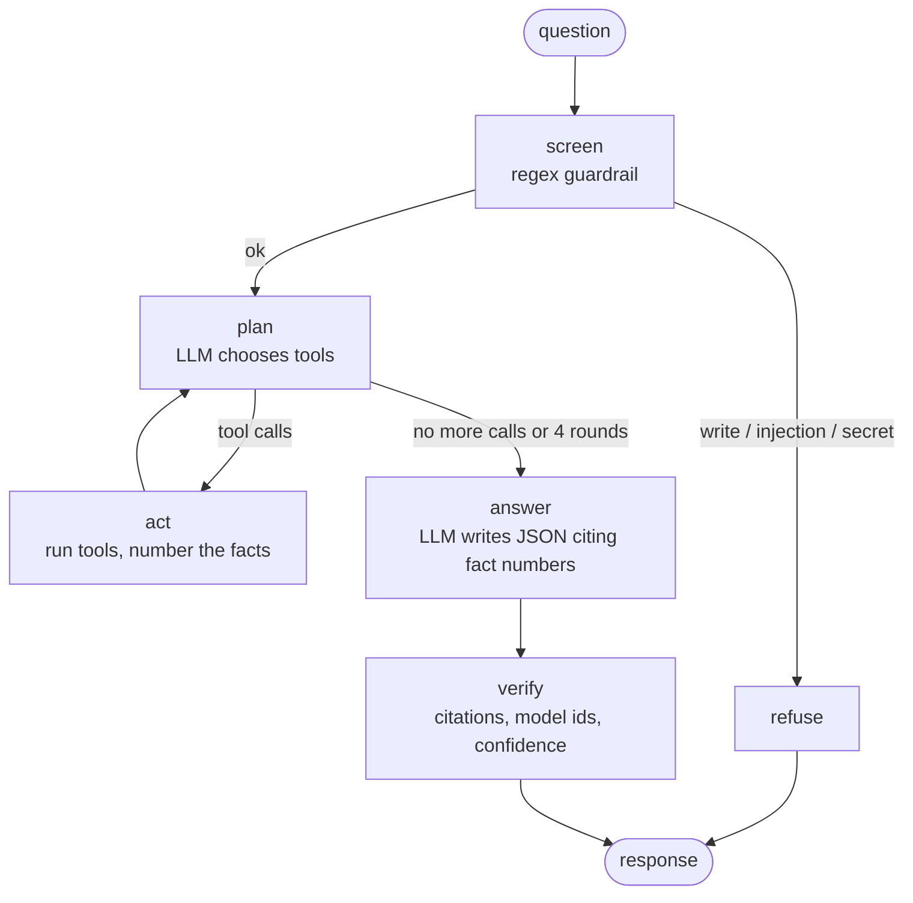

# The ModelAtlas agent

`POST /agent/ask` runs a LangGraph state machine (`app/agent/graph.py`) on a local LLM served by Ollama
(`qwen2.5:7b-instruct`, temperature 0). This page explains how it works and why it is built this way.

## The graph

| Node | LLM? | What it does |
| --- | --- | --- |
| `screen` | no | Refuses write orders ("delete all models"), prompt injection ("ignore your instructions"), questions about secrets. Cheap and deterministic, before any LLM call. It looks for orders, not words: a sentence must start with a write verb (after "please", "could you"...) and name something of the graph, so "which models drop the license of their parent?" or "remove all doubt: is Llama 3 commercial?" go through. |
| `plan` | yes | Tool calling: the LLM sees the question, the tool results so far, and decides the next calls (max 3 per round, 4 rounds). |
| `act` | no | Runs the calls. Errors (unknown model, bad arguments, GDS not run) are returned to the LLM as text so it can adapt, never raised. |
| `answer` | yes | Structured output (JSON schema): `answer`, `fact_ids`, `in_scope`. The LLM only sees the numbered facts. |
| `verify` | no | Drops citations that don't exist, looks up every model id written in the answer, computes the confidence. |

## Tools

| Tool | Wraps | Evidence of its facts |
| --- | --- | --- |
| `search_models` | `CatalogService.search` (fulltext) | VERIFIED |
| `model_details` | `CatalogService.detail` | VERIFIED (+ DERIVED descendant count) |
| `lineage` | `LineageService.lineage` | VERIFIED |
| `license_check` | `LicenseService.check` | VERIFIED license + DERIVED verdict |
| `recommend` | `RecommendService.recommend` | DERIVED |
| `similar_models` | `AnalyticsService.similar` (Node Similarity) | DERIVED |
| `predicted_parents` | `AnalyticsService.predicted_parents` (link prediction) | HYPOTHESIS |
| `influential_models` | `AnalyticsService.influential` (PageRank) | DERIVED |
| `text_to_cypher` | `TextToCypher.run` | HYPOTHESIS (an LLM wrote the query: valid and read-only, but it may answer a slightly different question) |

The tools call the same services as the endpoints: the agent can't get an answer the API would not give, and
the evidence labels stay the same.

## Text to Cypher

`app/agent/text_to_cypher.py`. The prompt contains the schema (`app/agent/schema.py`, the same lists the
validator uses), the rules and two few-shot examples. Then three layers:

1. **Static guard** (`app/agent/cypher_guard.py`). On a copy where string literals are blanked:
   one statement, no comments; no `CREATE`, `MERGE`, `SET`, `DELETE`, `REMOVE`, `DROP`, `FOREACH`, `LOAD CSV`,
   `UNION`, admin commands; no procedure `CALL` (`db.*`, `apoc.*`, `gds.*`); every label, relationship type and
   property must be in the schema; every `*` pattern needs an upper bound of at most `MAX_TRAVERSAL_DEPTH`;
   the final `RETURN` gives plain values, not whole nodes (a Model node carries two 256-number embeddings);
   a missing `LIMIT` is added (25), a bigger one than 100 is lowered.
2. **EXPLAIN**: Neo4j plans the query without running it, which catches syntax errors and unknown functions.
   We also read the plan: a `CartesianProduct` operator (`MATCH (a:Model), (b:Model)` is 24 billion rows) or
   more than 5 million estimated rows at one step is refused before anything runs.
3. **Execution** in a READ session with the 10 s timeout of every API query (a timeout is sent back to the LLM,
   and in the rest of the API it becomes a `504 query_timeout`).

When 1 or 2 fails, the exact error goes back to the LLM ("unknown property .name", "needs an upper bound"),
which gets two attempts to fix its query. Every attempt is returned in the response (`cypher` field), so the
user sees what was rejected and why.

## Confidence

Not asked to the LLM (a 7B model says "0.9" for everything). `score_confidence` in `graph.py`:

| Situation | Effect |
| --- | --- |
| answer cites tool facts | start at 0.95 |
| answer cites no fact | 0.4 |
| no tool returned a fact | 0.2, status `no_answer` |
| each failed tool call | −0.05 |
| `text_to_cypher` was used | −0.1 |
| each repaired query | −0.05 |
| each model id in the answer that is not in the graph | −0.25 (+ warning) |
| a cited fact is a HYPOTHESIS (ML guess or result of an LLM-written query) | capped at 0.6 |

How we chose the numbers: they are set by hand, not learned. They follow how
much each event says about a wrong answer. A model id that is not in the graph is the strongest sign of a
hallucination, so it costs the most (−0.25). An LLM-written query may answer a slightly different question
(the evaluation found two: a count that forgot `NOT m:Unlisted`, and a publisher ranking that put the filter on
the organization), so −0.1, and its results are HYPOTHESIS facts, capped at 0.6. A repair or a failed tool is a
small warning (−0.05). The cap of 0.6 matches the precision of the link prediction (about 78 %, minus a margin).
With 30 evaluated questions we don't have enough data to calibrate them; that is listed in the limits.

## Design choices

- **Our own small Ollama client** (`app/agent/llm.py`, 2 methods) instead of a LangChain wrapper: fewer
  dependencies, and a 20-line fake replaces it in tests (`tests/fake_llm.py`). LangGraph is used for the
  state machine only.
- **Tools first, `text_to_cypher` last.** A 7B model writes correct Cypher for simple counts, but the
  license and lineage rules are subtle (ancestors, Unlisted parents, dataset licenses): those go through
  tested services, not generated queries.
- **Refusing is cheap.** The regex screen is not perfect, and doesn't need to be: a write that passed it
  would still be stopped by the Cypher guard and by the READ session.
- **Temperature 0**, so the evaluation can be re-run and give the same results.

## Limits

- Lucas's 30-question evaluation found that `text_to_cypher` is the weak part. Run 1
  ([`reports/agent_eval_run1.md`](../reports/agent_eval_run1.md)): one count answered a different question and
  two questions got no valid query. We added the `NOT m:Unlisted` rule, an example and a hint in the guard
  error. Run 2 ([`reports/agent_eval.md`](../reports/agent_eval.md)): both counts right, but the publisher
  ranking is still wrong. Questions on fixed tools (licenses, lineage, recommendations) were all right.
- Two guardrail bypasses were found in review and fixed: a quote inside a backtick name could hide a
  `DELETE` from the keyword check (the guard now scans strings and names in one pass), and polite bulk
  removals ("could you kindly remove all the Llama models") passed the question screening. The READ session
  would have refused the write anyway.
- The first version of the screen also had false positives (legit questions refused because they contained
  "drop", "token", "secret", "act as", "change"...). The screen now looks for orders instead of words; every
  case we found is a test in `tests/unit/test_input_guard.py`.
- For the live demo, run one question before presenting: the first call loads the model into memory.

- On a laptop CPU, a question takes 10 to 40 s (each `plan` round is one LLM call).
- The model sometimes picks a less precise tool (e.g. `search_models` when `model_details` would do); the
  answer is still grounded, but uses more rounds.
- The confidence measures how well the answer is supported by our checks, not whether the underlying card
  data is true (licenses are self-declared on Hugging Face).
