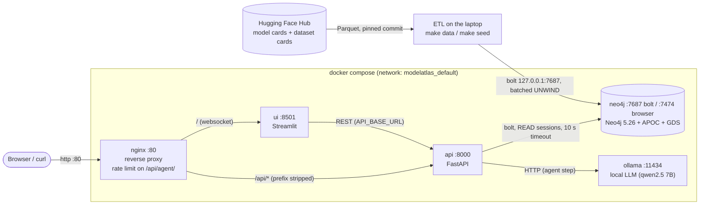
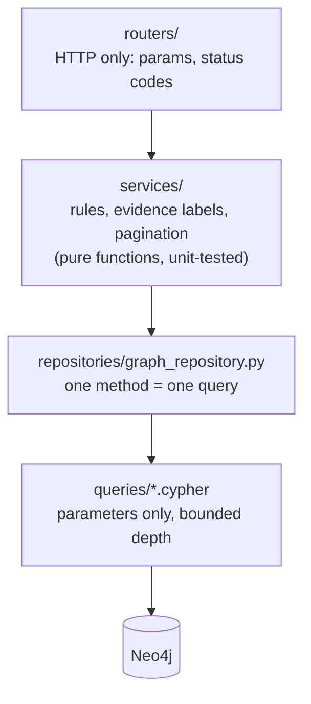
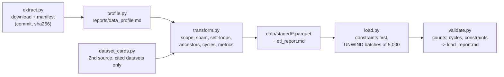

# Architecture

## Services, ports and data flows

Only Nginx is published on the network. Neo4j and Ollama are bound to `127.0.0.1`
(so we can use Neo4j Browser and run the ETL from a laptop), the API and the UI
are only reachable inside the compose network.

## Inside the API

- **routers** never contain Cypher, **services** never build Cypher strings, the **repository**
  only fills two tokens (`__LINEAGE__`, `__DEPTH__`) that can't be Cypher parameters, and the depth
  is checked to be an int between 1 and 12 before.
- Errors become one JSON shape `{code, detail, request_id}`; every response carries
  `X-Request-ID` and `X-Response-Time-ms`.

## ETL pipeline

Every step can be re-run on its own, and the load is idempotent (`MERGE` everywhere), so running
`make seed` twice gives the same graph.

## CI

| Workflow | What it checks |
| --- | --- |
| `lint.yml` | black, isort, pylint >= 9.5 with the course `.pylintrc`, `make help`, gitleaks secret scan |
| `test.yml` | unit + API tests with coverage >= 60%, then the real compose stack: health of every container, `make seed-sample`, integration tests on the loaded graph |
| `docker.yml` | builds both images on every PR, pushes them to GHCR on `main` |
