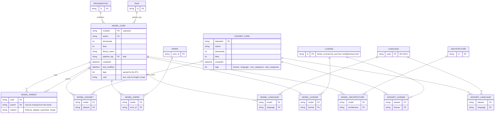

# ER diagram of the source data

Our data comes as two Parquet tables, not as a graph: one row per **model card**
(`librarian-bots/model_cards_with_metadata`) and one row per **dataset card**
(`librarian-bots/dataset_cards_with_metadata`). Most of the relations are hidden in a
`tags` list column (`license:apache-2.0`, `base_model:finetune:org/name`, `dataset:org/name`,
`arxiv:2305.18290`, `en`...). The ETL ([`scripts/etl/tags.py`](../scripts/etl/tags.py))
splits those tags into the entities and link tables below. This is the relational
model we start from; [`modeling.md`](modeling.md) explains how it becomes the graph.

## From tables to the graph

| Relational side | Graph side | Why it changed |
| --- | --- | --- |
| `MODEL_CARD` row | `(:Model)` node | one node per model, the scalar columns become properties |
| `MODEL_PARENT` (self-join on `MODEL_CARD`, with a `relation` column) | 4 relationship types `FINETUNED_FROM`, `ADAPTER_OF`, `QUANTIZED_FROM`, `MERGED_FROM` | a family tree is a recursive self-join in SQL (one join per generation); in Neo4j it is one bounded variable-length pattern, and the type filters the expansion |
| `MODEL_PARENT.parent` with no `MODEL_CARD` row (22% of the edges) | `(:Model:Unlisted)` node | the foreign key would be broken in SQL; in the graph we keep the node so the tree and the license check don't stop there |
| `author` column | `(:Organization)` + `PUBLISHED_BY` | "who builds on X" groups by publisher without a full scan |
| `MODEL_LICENSE`, `DATASET_LICENSE` | `(:License)` + `HAS_LICENSE` from models **and** datasets | one place for the license rules, shared by models and their training data |
| one license per model, several per dataset | a model has zero or one license, a dataset zero or many | the Hub writes one `license:` tag per model in practice (none of the 2,001 models of our test sample has two), while 58 datasets declare several, so only datasets keep the full list. If a model had several, the ETL keeps the first one (`ParsedTags.license`) and the license check would miss the others: a known limit |
| `MODEL_DATASET` | `TRAINED_ON` | link table becomes a relationship |
| `MODEL_DATASET.dataset` with no `DATASET_CARD` row | `(:Dataset {listed: false})` | cited but no card: license unknown, see modeling.md §7 |
| `MODEL_PAPER`, `MODEL_LANGUAGE`, `DATASET_LANGUAGE` | `CITES`, `SUPPORTS` | link tables become relationships |
| `pipeline_tag` | `(:Task)` + `PERFORMS`, also copied as `Model.task` (range index) | the node groups models by task; the copy makes the frequent `task = ...` filter an index seek |
| architecture tags (`llama`, `mistral`...) in `tags` | `(:Architecture)` + `HAS_ARCHITECTURE` | same idea as tasks, only for the tags we know (`config/scope.toml`) |
| `DATASET_CARD.tags` (size, task categories) | `Dataset.size_category`, `Dataset.task_categories` properties | shown, never traversed |

The full property list of the graph is in [`docs/diagrams/graph_schema.png`](diagrams/graph_schema.png)
and in the constraints and indexes of [`app/database/schema.py`](../app/database/schema.py).
