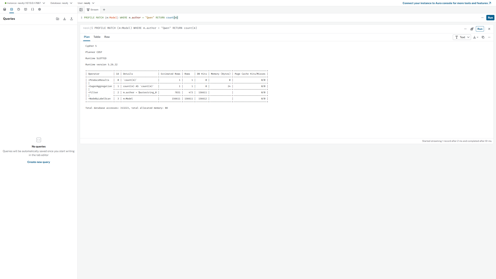
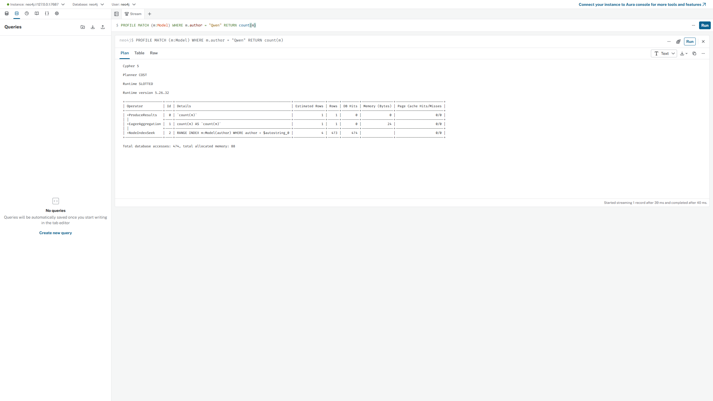
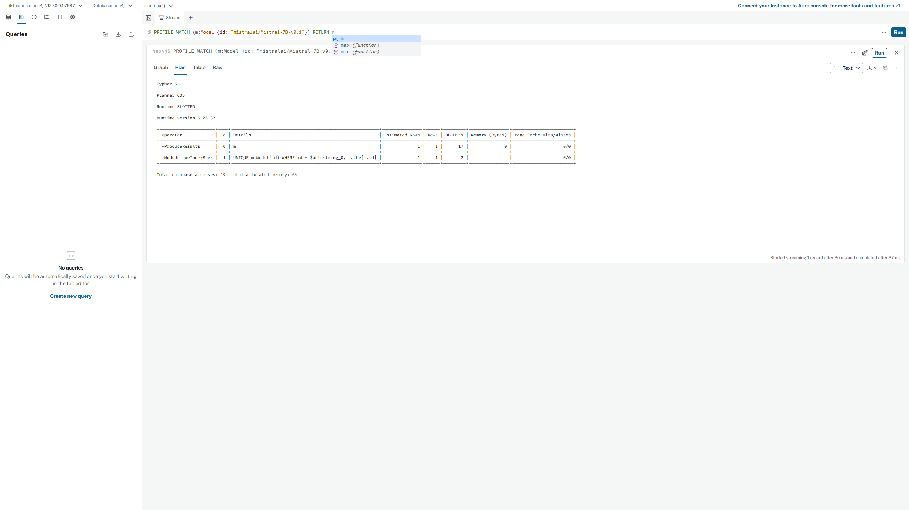
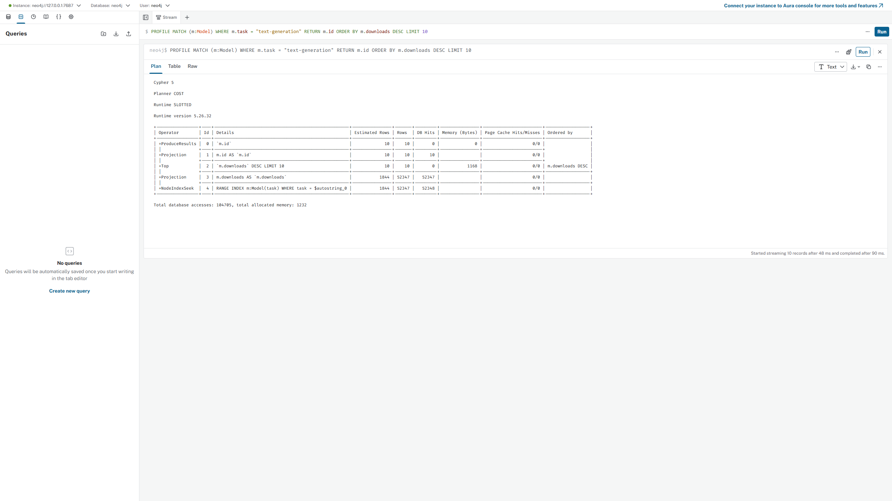
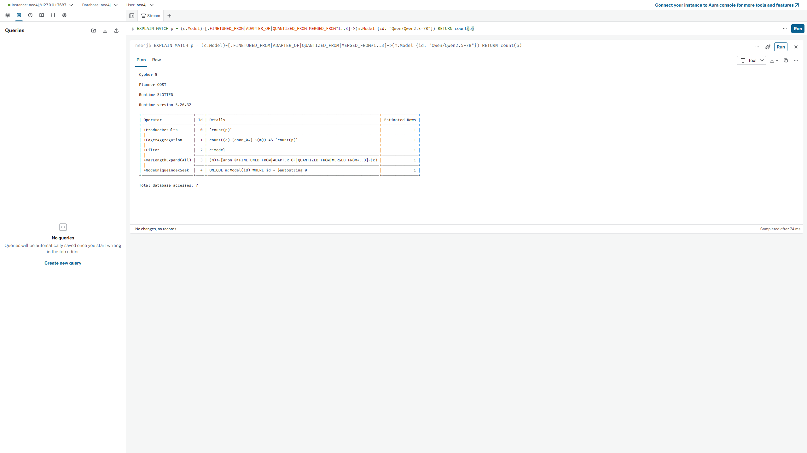

# Reading EXPLAIN and PROFILE plans

Measured on **16 October 2026**, using Neo4j Community **5.26.32**, the SLOTTED runtime,
and the full local graph: **156,611 Model nodes**, including **6,105 Unlisted nodes**.
Neo4j runs in Docker Desktop with a 2 GB heap and 2 GB page cache.

`EXPLAIN` builds a plan without running the query. Its row counts are estimates.
`PROFILE` runs the query and adds actual rows and database hits to each operator.
A database hit is a logical storage access, not necessarily a disk read. Cached
data still produces db hits. We compare these counts because time also depends
on cache state, planning, the driver and other work on the laptop.

The screenshots below are real Neo4j Browser captures from the **Plan** tab in
its **Text** view. They retain the query, operator table, total hits and footer.
[Raw evidence](img/explain_profile/measurements.json) includes the driver plan
trees, Browser text and all repeated author-query timing samples. No values were
estimated to fill missing measurements.

Read a plan from its bottom operator towards `ProduceResults` at the top. For a
branched plan, follow each input branch before reading the operator that joins them.

## 1. Author lookup before the index

```cypher
PROFILE MATCH (m:Model)
WHERE m.author = "Qwen"
RETURN count(m)
```



There was no range index on `Model.author` for this capture. The fulltext
`model_search` index does not serve this equality predicate.

From bottom to top:

1. `NodeByLabelScan` visits all **156,611** Model nodes: **156,612 db hits**.
2. `Filter` reads their `author` property and keeps **473** nodes: **156,611 db hits**.
3. `EagerAggregation` counts those nodes and returns one row containing **473**.
4. `ProduceResults` sends that one row to the client.

The total is **313,223 db hits**. The one returned row is a count, not one model.
The plan calls the literal `$autostring_0`: this is Neo4j's automatic
parameterization of the string, not a parameter we supplied.

## 2. The same author lookup after the index

Create the temporary index and wait until it is online:

```cypher
CREATE INDEX model_author IF NOT EXISTS FOR (m:Model) ON (m.author);
CALL db.awaitIndexes(300);
```

Then run exactly the same query:

```cypher
PROFILE MATCH (m:Model)
WHERE m.author = "Qwen"
RETURN count(m)
```



From bottom to top:

1. `NodeIndexSeek` looks up `Qwen` in `model_author` and finds **473** nodes:
   **474 db hits**.
2. `EagerAggregation` counts the matches.
3. `ProduceResults` returns the same count, **473**.

The scan and property filter have disappeared. Total hits drop from **313,223**
to **474**, a **660.81x** reduction in logical storage work.

These are the exact numbers shown in the two Browser captures:

| Author query | Db hits | Browser started streaming after (ms) | Browser completed after (ms) |
| --- | ---: | ---: | ---: |
| Before index | 313,223 | 2 | 61 |
| After index | 474 | 39 | 40 |

These are single PROFILE executions. The first execution after changing the
schema also needs a new plan, so it is not a fair steady-state latency comparison.
We retain both footer numbers rather than choosing only the more favorable one.

For a separate latency comparison, we ran the same count query **without PROFILE**,
with **3 warm-ups and 30 timed runs** in each state. A Python client measured wall
time around query execution, fetching every row and consuming the summary. Session
creation was outside timing. The before block ran first, then the after block;
there was no cache flush. Percentiles use linear interpolation.

| Author query | p50 ms | p95 ms | Count returned | Profile db hits |
| --- | ---: | ---: | ---: | ---: |
| Before index | 67.965 | 80.904 | 473 | 313,223 |
| After index | 2.097 | 2.694 | 473 | 474 |

The measured median speed-up is **32.40x**. This result applies to this author and
this laptop; it does not mean that every query becomes 32 times faster.

## 3. Lookup by a unique model id

```cypher
PROFILE MATCH (m:Model {id: "mistralai/Mistral-7B-v0.1"})
RETURN m
```



From bottom to top:

1. `NodeUniqueIndexSeek` uses the index behind the `model_id` uniqueness
   constraint. It finds one node with **2 db hits**.
2. `ProduceResults` returns the complete node. Reading its properties adds
   **17 db hits**, giving **19 db hits** in total.

Browser started streaming after **30 ms** and completed after **37 ms**. Those
single-run timings include work that a simple id-only return would not need.

The uniqueness constraint both prevents duplicate ids and supplies a range index.
The loader's `MERGE` operations by id can therefore use indexed lookups, as can
the API's `MATCH` queries. The exact operator for a writing `MERGE` can differ
from this read plan, but it does not need to scan every Model node to find an id.

## 4. ORDER BY and LIMIT

```cypher
PROFILE MATCH (m:Model)
WHERE m.task = "text-generation"
RETURN m.id
ORDER BY m.downloads DESC
LIMIT 10
```



From bottom to top:

1. `NodeIndexSeek` uses **model_task**, finding **52,347** matching nodes:
   **52,348 db hits**.
2. `Projection` reads their downloads: **52,347 db hits**.
3. `Top` keeps the best **10** rows by downloads, rather than collecting the
   entire sorted result. Its reported memory is **1,168 bytes**.
4. A second `Projection` reads the ten returned ids: **10 db hits**.
5. `ProduceResults` returns those ten ids.

The total is **104,705 db hits**. Browser started streaming after **48 ms** and
completed after **90 ms**.

This plan **does not use index order on downloads**. It uses the task index and
a `Top` operator. An index existing on `downloads` does not mean the planner will
choose it for every ranking query. LIMIT saves sorting memory and result work,
but this particular plan still examines all matching task nodes. Placing LIMIT
before the ranking would instead change which models are selected.

The task-sheet query has no secondary ordering for tied downloads. That is fine
for inspecting this plan; repeatable benchmark comparisons use `id` as a tie-breaker.

## 5. EXPLAIN a bounded lineage traversal

```cypher
EXPLAIN MATCH p = (c:Model)
  -[:FINETUNED_FROM|ADAPTER_OF|QUANTIZED_FROM|MERGED_FROM*1..3]->
  (m:Model {id: "Qwen/Qwen2.5-7B"})
RETURN count(p)
```



From bottom to top:

1. `NodeUniqueIndexSeek` first finds the root model by id.
2. `VarLengthExpand(All)` follows incoming lineage edges from that root, for
   one to three hops. Stored edges point from child to parent, so walking them
   backwards finds descendants.
3. `Filter` checks that the reached nodes have the Model label.
4. `EagerAggregation` counts paths. A descendant with several different paths
   can contribute more than once: `count(p)` is not `count(DISTINCT c)`.
5. `ProduceResults` would return the count if the query were executed.

There are **no measured db hits or actual result counts** here. Browser displays
`Total database accesses: ?` and `Completed after 74 ms`. The latter is planning
time for EXPLAIN, not the time to execute this traversal.

[The data profile](../reports/data_profile.md) shows that about **99.6%** of the
reported model chains have depth at most five. That supports a small default
depth, but it does not prove that every family fits within that limit. More hops
can multiply the number of candidate paths, especially with merges. A bound
limits expansion; the API's timeout provides another limit on expensive reads.

The benchmark task makes a related comparison at depth six. On this loaded graph,
Qwen/Qwen2.5-7B has **1,894** distinct descendants in total and **1,891** within six
hops; its longest descendant path has seven hops. Comparing those two raw counts
as if they were identical answers would be wrong. The benchmark's unbounded
variant filters path length after expansion so that both variants return the
same six-hop result. A pruning plan can still have more db hits than an all-paths
plan on this small family; bounding depth is not a promise of a faster execution.

## 6. Indexes and the features they serve

This table follows the purposes documented in
[schema.py](../app/database/schema.py). A purpose is not proof that a particular
query uses that index: PROFILE is how we check the actual choice.

| Index or constraint-backed index | Intended feature or use |
| --- | --- |
| `model_id` | Model pages, lineage roots and ETL MERGE by model id |
| `organization_id` | Publisher lookups and organization footprint |
| `license_id` | License lookups and ETL license linking |
| `dataset_id` | Training-dataset linking and dataset identity |
| `paper_id` | Paper linking and arXiv identity |
| `task_id` | Task identity and PERFORMS links |
| `language_code` | Language identity and SUPPORTS links |
| `architecture_id` | Architecture identity and HAS_ARCHITECTURE links |
| `model_downloads` | Download rankings and pagination |
| `model_likes` | Popularity rankings by likes |
| `model_task` | Task filtering for recommendations and rankings; used in section 4 |
| `model_params` | Model-size filters for recommendations |
| `model_created` | Date filters for families and a temporal ML split |
| `model_descendants` | Ranking model families by precomputed descendant count |
| `license_family` | Intended for license-family grouping or filtering |
| `model_search` (fulltext) | Search bar and planned agent entity resolution |
| `model_author` (temporary) | Direct author-property equality; tested in sections 1 and 2 |

Some entries support planned features. For example, the current license-check
query reaches License nodes through relationships and reads `family`; that read
alone does not use `license_family` as a seek. The created-date and likes indexes
also should not be described as used by the plans captured here.

## 7. Cleanup and recommendation

After the experiment, we removed only the index we created:

```cypher
DROP INDEX model_author IF EXISTS;
```

The final schema has the repository's original indexes. A rerun of this exercise
should first check that `model_author` is absent; do not drop an index that someone
else created just to obtain the desired baseline. Run the benchmark without this
temporary index, otherwise its author scan experiment changes meaning.

For a direct `WHERE m.author = ...` lookup, this index clearly helps: **313,223 to
474 db hits**, with median latency **67.965 to 2.097 ms**. We would add it permanently
if direct author filtering becomes a frequent API requirement. For the current
publisher feature, we recommend using the existing unique Organization lookup and
`PUBLISHED_BY` relationship first, and leaving the permanent schema unchanged.
That avoids another index to update during imports and another use of memory and
storage. We did not measure import overhead or index size, so we do not assign
numbers to those costs.

## Reproducing the evidence

Start the stack and load the full graph using the README. Open Neo4j Browser at
`http://127.0.0.1:7474` and connect using the local `.env` credentials. Run sections
1 through 5 in order, save each **Plan → Text** screenshot, and finish with the
cleanup statement above. Record both Browser footer timings; do not substitute
EXPLAIN planning time for query execution time.

For the repeated author timings, run the unprofiled count query three times to warm
up, then time 30 fully consumed executions before creating the index. Create it,
wait for `db.awaitIndexes(300)`, and repeat the same procedure. Profile once in
each state for the db-hit comparison. The exact samples used here are included in
the raw evidence, separate from the Browser captures.

Neo4j's [execution-plan documentation](https://neo4j.com/docs/cypher-manual/5/planning-and-tuning/execution-plans/)
explains the operators; its [parameter documentation](https://neo4j.com/docs/cypher-manual/5/syntax/parameters/)
describes the automatic literal parameters visible in these plans.
